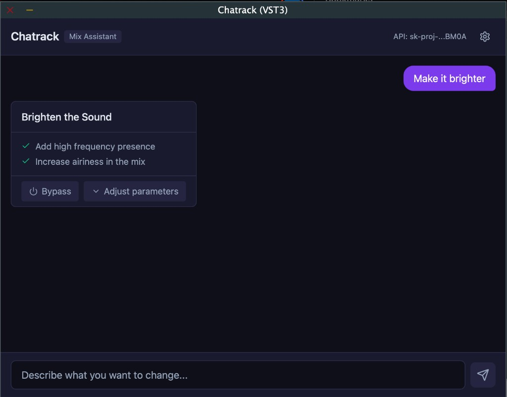
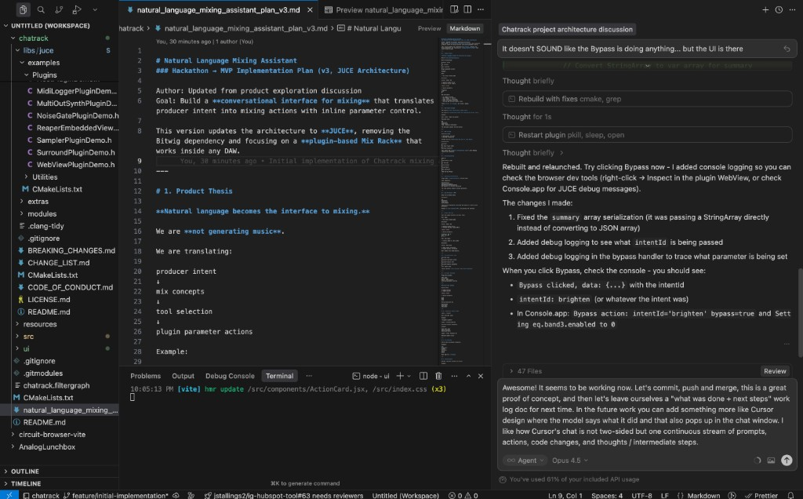

# Chatrack Work Log

## Session: March 12, 2026 - Initial Implementation

### What Was Done

Built a working proof-of-concept of Chatrack, a conversational mixing assistant audio plugin.



#### Architecture Implemented

- **JUCE 8 Plugin** with embedded WebView UI
- **React + Tailwind + Vite** frontend in `ui/`
- **CMake** build system with JUCE as a git submodule
- **WebView Bridge** for bidirectional JS ↔ C++ communication

#### Core Features Working

1. **Chat Interface** - Send natural language requests like "Make it brighter"
2. **LLM Integration** - OpenAI API for intent classification
3. **Recipe Engine** - Maps intents to DSP parameter changes
4. **DSP Chain** - EQ (4 bands), Compressor, Saturation, Stereo Width
5. **Action Cards** - Visual feedback with expandable parameter knobs
6. **Bypass Toggle** - A/B compare effect on/off
7. **Real-time Parameter Tweaking** - Adjust knobs, hear changes immediately

#### Technical Challenges Solved

- **WebView timing** - Used `juce::Timer` to delay URL loading until component visible
- **WebKit security** - Custom `ChatrackWebView` subclass to allow localhost navigation
- **Native function bridge** - Proper JSON serialization between JS and C++
- **API key persistence** - Saved to user app data directory
- **HTTP headers for JUCE** - Correct `\r\n` formatting for `withExtraHeaders()`

### Next Steps

#### High Priority

1. **Continuous Chat Stream UI** - Like Cursor's design where model outputs, actions, and intermediate steps flow as one continuous stream (not two-sided conversation bubbles)
   - Model explains what it's doing
   - Shows parameter changes inline
   - Thoughts/reasoning visible to user
   
   *UI Inspiration (Cursor):*
   

2. **Multi-level Undo** - Ctrl+Z style undo for individual parameter tweaks
   - Track each knob change in ActionHistory
   - Allow reverting to any previous state

3. **Undo vs Bypass clarity** - Undo reverts to before the action, Bypass toggles on/off

#### Medium Priority

4. **Better DSP audibility** - Current EQ may be subtle on laptop speakers
   - Consider adding gain staging
   - Visual feedback (meters, spectrum)

5. **Conversation context** - Pass previous messages to LLM for follow-ups
   - "Make it even brighter" should reference previous action

6. **Parameter presets** - Save/load favorite settings

7. **Visual EQ curve** - Show the EQ shape being applied

#### Lower Priority

8. **Local LLM support** - Ollama/llama.cpp integration for offline use
9. **VST3 preset system** - Proper DAW state save/restore
10. **AU validation** - Test and fix Audio Unit build
11. **Windows testing** - WebView2 backend verification

### Code Structure

```
chatrack/
├── src/
│   ├── PluginProcessor.cpp/h    # Audio processing, state management
│   ├── PluginEditor.cpp/h       # WebView host, native functions
│   ├── dsp/
│   │   ├── RackProcessor.*      # DSP chain orchestration
│   │   ├── EQProcessor.*        # 4-band parametric EQ
│   │   ├── CompressorProcessor.* 
│   │   ├── SaturationProcessor.*
│   │   └── StereoWidthProcessor.*
│   ├── engine/
│   │   ├── RecipeEngine.*       # Intent → parameter mapping
│   │   ├── RackController.*     # Parameter application
│   │   └── ActionHistory.*      # Undo/redo snapshots
│   └── llm/
│       ├── LLMService.h         # Abstract interface
│       ├── CloudLLMProvider.*   # OpenAI implementation
│       └── IntentParser.*       # JSON response parsing
├── ui/
│   ├── src/
│   │   ├── App.jsx              # Root component
│   │   ├── components/
│   │   │   ├── ChatWindow.jsx   # Message list
│   │   │   ├── ChatInput.jsx    # Text input
│   │   │   ├── ActionCard.jsx   # Recipe result card
│   │   │   └── ParameterKnob.jsx # Rotary control
│   │   └── juce/                # JUCE JS bridge (copied from JUCE)
│   └── package.json
├── resources/
│   └── recipes.json             # Intent definitions
└── docs/
    └── WORKLOG.md               # This file
```

### Session Notes

- Plugin loads in AudioPluginHost via `chatrack.filtergraph`
- After a plugin build, relaunch the host: `./scripts/run-host.sh` (or `cmake --build build --target run_host --config Debug`)
- Master A/B bypasses the whole rack. It does not gain-match yet.
- Test loop: `resources/test-loop.wav` — load it in AUAudioFilePlayer once and File → Save if the player is empty
- Dev server: `cd ui && npm run dev` (localhost:5173)
- Build: `cmake --build build --config Debug`
- Debug logs visible in Console.app (search for "Chatrack" or "AudioPluginHost")
